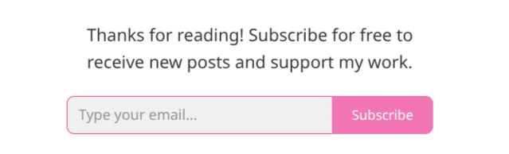

# follow

A self-hosted, Substack-style "subscribe for new posts" box for static blogs. Readers subscribe on your site; you announce a new post by running a CLI that emails a short hand-written note plus the link.



```
blog page ──(follow.js + Turnstile)──▶ Cloudflare Worker ──▶ D1 (subscribers)
                                                                ▲
your laptop: npm run send ──(D1 API, scoped token)──────────────┘
                   └──▶ Resend ──▶ inboxes ──(one-click unsubscribe)──▶ Worker
```

- **Widget:** one `<script>` tag, no dependencies. Colors are customizable, and it follows light/dark mode.
- **Backend:** a Cloudflare Worker + D1, with bot protection (Turnstile), rate limiting and an origin allowlist. There is **no endpoint that lists subscribers**.
- **Email:** sent from your own domain through Resend (pluggable). It includes one-click unsubscribe. Sends are resumable and never duplicate.

## Get started

1. Follow [docs/setup.md](docs/setup.md). Or, in Claude Code, run the **`/new-setup`** skill, which guides you through each step and checks it.
2. Embed the widget on your posts: [docs/widget.md](docs/widget.md).

## Announce a post

```sh
npm run send -- --post-url https://example.com/posts/foo/ --subject "New post: Foo" --body note.md --test you@example.com  # preview to yourself
npm run send -- --post-url https://example.com/posts/foo/ --subject "New post: Foo" --body note.md --dry-run               # who'd get it
npm run send -- --post-url https://example.com/posts/foo/ --subject "New post: Foo" --body note.md                         # send
```

To send in chunks or to a hand-picked list, use `npm run export` and `--csv`. See [docs/setup.md](docs/setup.md#sending-in-chunks-eg-resends-free-100day).

## Develop

```sh
npm install
npm test && npm run typecheck
npm run verify:start   # isolated local stack plus about 24 end-to-end checks; stop it with npm run verify:stop
```

In Claude Code, the **`verify-everything`** skill adds a real-browser pass. Security design: [docs/security.md](docs/security.md).

## License

MIT
